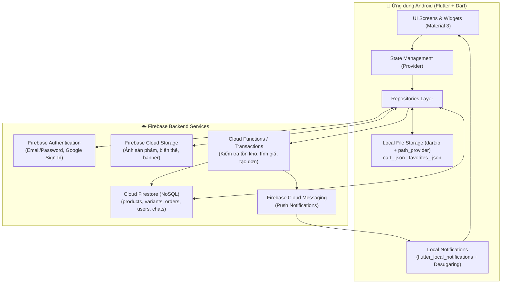

# 📱 SmartStore – Hệ Thống Bán Điện Thoại Di Động (PRM393)

> **Môn học:** PRM393 – Mobile Programming (Flutter & Dart)  
> **Nền tảng mục tiêu:** Android (Chuyên biệt hóa cấu hình Gradle, Desugaring, Permissions & Material 3)  
> **Quy mô nhóm:** 3 thành viên (Tỷ lệ đóng góp: 34% – 33% – 33%)  
> **Kiến trúc lưu trữ:** **Local JSON File Storage** (`path_provider`) + **Cloud Firestore** + **Firebase Auth** + **Firebase Storage**

---

## 1. Giới thiệu dự án

**SmartStore** là ứng dụng thương mại điện tử (Mobile E-commerce Application) chuyên kinh doanh điện thoại di động và phụ kiện công nghệ. Ứng dụng hỗ trợ trọn vẹn quy trình mua sắm thực tế: từ đăng ký/đăng nhập tài khoản, tìm kiếm & lọc sản phẩm, **chọn biến thể điện thoại (Màu sắc, RAM, ROM)** theo giá và tồn kho thời gian thực, quản lý giỏ hàng & danh sách yêu thích **Offline bằng Local File Storage**, đặt hàng an toàn qua xác thực Server, nhận thông báo đẩy/cục bộ (`flutter_local_notifications` + `FCM`), đến theo dõi đơn hàng và quản trị hệ thống dành cho Admin.

---

## 2. Kiến trúc tổng quan (Đã chốt theo định hướng giảng viên)

Theo góp ý của giảng viên môn **PRM393**, dự án sử dụng **Local File Storage (lưu file JSON cục bộ trên thiết bị Android)** thay cho SQLite để xử lý dữ liệu Offline (Giỏ hàng, Yêu thích), kết hợp chặt chẽ với hệ sinh thái **Firebase**.



### Phân chia trách nhiệm lưu trữ dữ liệu

| Công nghệ / Thành phần | Dữ liệu & Trách nhiệm đảm nhiệm |
| :--- | :--- |
| **Local File Storage (`path_provider` + `dart:io`)** | Lưu trữ giỏ hàng cục bộ (`cart_<uid>.json`), danh sách yêu thích (`favorites_<uid>.json`), hỗ trợ **Offline Mode** |
| **Shared Preferences (`shared_preferences`)** | Lưu cài đặt nhẹ: trạng thái Onboarding, Dark/Light Theme, từ khóa tìm kiếm gần đây |
| **Firebase Authentication** | Quản lý tài khoản, đăng ký/đăng nhập Email & Password, Google Sign-In, khôi phục mật khẩu, UID & phân quyền |
| **Cloud Firestore** | Cơ sở dữ liệu chính: Sản phẩm (`products`), Biến thể SKU (`variants`), Thương hiệu (`brands`), Đơn hàng (`orders`), Người dùng (`users`), Chat (`chats`), Thông báo (`notifications`) |
| **Firebase Cloud Storage** | Lưu trữ file media: Ảnh điện thoại theo từng màu, banner trang chủ, ảnh đại diện người dùng |
| **Cloud Functions / Firestore Transactions** | Đặt hàng an toàn (Atomic Transaction), kiểm tra tồn kho thực tế, xác minh giá phía server trước khi tạo đơn |
| **FCM + `flutter_local_notifications`** | Nhận thông báo đẩy từ server và hiển thị Notification Banner trực tiếp trên Android |

---

## 3. Danh mục tài liệu dự án (`docs/`)

Toàn bộ thiết kế kỹ thuật, cấu hình Android và kế hoạch triển khai của nhóm được chia thành 5 tài liệu chuyên sâu trong thư mục `docs/`:

1. 📄 **[01_PROJECT_REQUIREMENTS_AND_FEATURES.md](docs/01_PROJECT_REQUIREMENTS_AND_FEATURES.md)**  
   *Đặc tả toàn bộ chức năng Khách hàng (F01–F23), Admin (A01–A10), Hệ thống tự động (S01–S08), Quy trình mua hàng 7 bước, Yêu cầu phi chức năng và Lộ trình 3 giai đoạn (MVP → Nâng cao).*
2. 🗄️ **[02_ARCHITECTURE_AND_DATABASE_DESIGN.md](docs/02_ARCHITECTURE_AND_DATABASE_DESIGN.md)**  
   *Kiến trúc mã nguồn Flutter (Feature-first + Layered + Provider), Cấu trúc thư mục `lib/`, Thiết kế chi tiết Cloud Firestore Schema (`products`, `variants`, `orders`), Thiết kế Local JSON File Storage, Cơ chế đồng bộ Offline ↔ Cloud và Firestore Security Rules.*
3. 🤖 **[03_ANDROID_SETUP_AND_PACKAGES.md](docs/03_ANDROID_SETUP_AND_PACKAGES.md)**  
   *Hướng dẫn cấu hình chuyên biệt cho nền tảng Android (PRM393): Danh sách thư viện `pubspec.yaml`, cấu hình `build.gradle.kts` (`compileSdk`, Java 17, `isCoreLibraryDesugaringEnabled = true`), `AndroidManifest.xml` và code mẫu `CartFileStorage` & `LocalNotificationService`.*
4. 🎨 **[04_UI_UX_AND_SCREENS_SPEC.md](docs/04_UI_UX_AND_SCREENS_SPEC.md)**  
   *Định hướng thiết kế giao diện (Design System), sơ đồ điều hướng (Bottom Navigation & GoRouter), danh sách chi tiết 22 màn hình và đặc tả chuyên sâu màn hình Chi tiết sản phẩm (chọn biến thể).*
5. 👥 **[05_TEAM_PLAN_TESTING_AND_REPORT_GUIDE.md](docs/05_TEAM_PLAN_TESTING_AND_REPORT_GUIDE.md)**  
   *Phân chia công việc nhóm 3 thành viên (34% – 33% – 33%), lộ trình 6 tuần, bảng 18 kịch bản kiểm thử (TC01–TC18), kịch bản trình diễn Demo và hướng dẫn cập nhật Technical Report.*

---

## 4. Tóm tắt phân công nhóm (3 Thành viên)

| Thành viên | Tỷ lệ | Phụ trách chính |
| :--- | :---: | :--- |
| **Member A** | **34%** | Thiết lập Firebase Project, Authentication, Firestore Schema, **Local File Storage Service (`cart.json`, `favorites.json`)**, Order Repository, Xử lý đặt hàng (Transactions/Cloud Functions), Firestore Security Rules. |
| **Member B** | **33%** | Design System & Theme, UI các màn hình: Splash, Auth, Home, Product List, **Product Detail (chọn Variant)**, Cart, Checkout UI, Profile, Responsive Layout trên Android. |
| **Member C** | **33%** | Hệ thống State Management (`Provider`), Cơ chế đồng bộ **Local File Storage ↔ Firestore**, Wishlist, Order History & Detail, Thông báo (`FCM` + `flutter_local_notifications`), Chat, Google Maps, Integration Testing. |

---

## 5. Khởi chạy nhanh cho môi trường Android

```bash
# 1. Kiểm tra phiên bản Flutter và môi trường Android SDK
flutter --version
flutter doctor -v

# 2. Tải toàn bộ dependencies
flutter pub get

# 3. Chạy ứng dụng trên máy ảo Android (Emulator) hoặc thiết bị thật
flutter run

# 4. Build file cài đặt APK Release để nộp đồ án
flutter build apk --release
```
