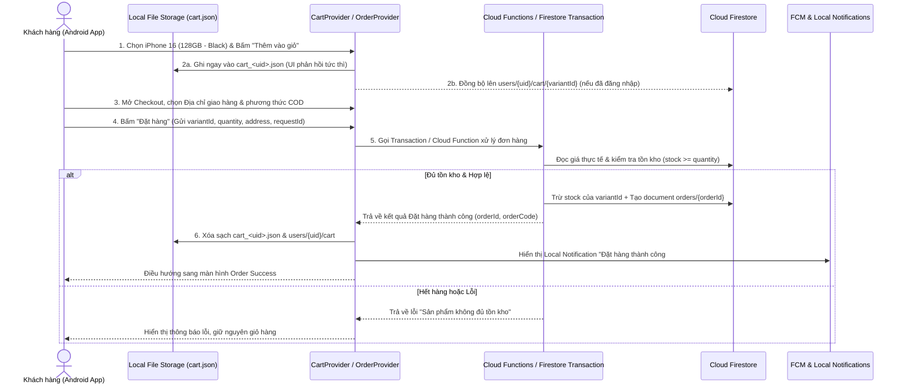
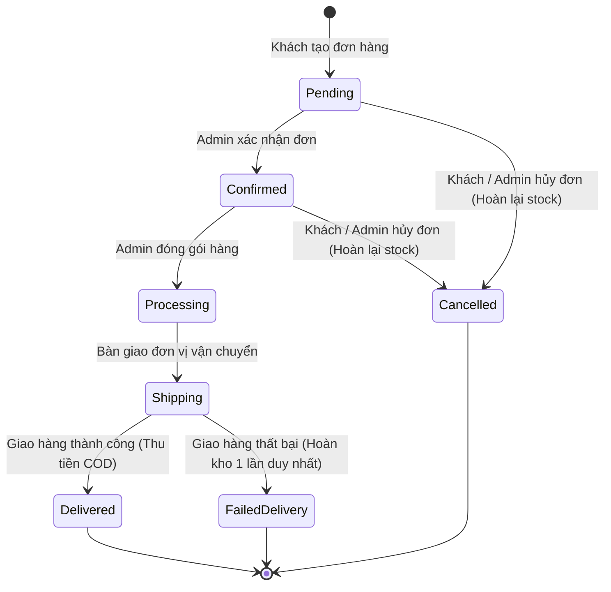

# 📋 01. Đặc Tả Yêu Cầu & Chức Năng Hệ Thống (Project Requirements)

> **Dự án:** SmartStore – Hệ thống bán điện thoại di động  
> **Môn học:** PRM393 – Mobile Programming (Flutter Android)

---

## 1. Phân nhóm chức năng toàn hệ thống

Hệ thống **SmartStore** được chia thành 3 phân hệ chức năng rõ ràng: **Khách hàng (Customer)**, **Quản trị viên (Admin)** và **Hệ thống tự động (System)**.

### 1.1. Chức năng dành cho Khách hàng (Customer – 23 chức năng)

| Mã | Chức năng | Nội dung chi tiết |
| :---: | :--- | :--- |
| **F01** | **Đăng ký tài khoản** | Đăng ký bằng Email/Password qua Firebase Auth, gửi email xác thực tài khoản. |
| **F02** | **Đăng nhập / Đăng xuất** | Xác thực qua Firebase Auth, hỗ trợ Google Sign-In, tự động duy trì phiên đăng nhập. |
| **F03** | **Quên mật khẩu** | Gửi email chứa đường dẫn khôi phục mật khẩu qua Firebase Auth. |
| **F04** | **Trang chủ (Home)** | Hiển thị Carousel Banner khuyến mãi, danh mục hãng, điện thoại nổi bật và mới nhất. |
| **F05** | **Danh mục (Catalog)** | Phân loại theo hãng: iPhone (Apple), Samsung, Xiaomi, OPPO và Phụ kiện công nghệ. |
| **F06** | **Tìm kiếm** | Tìm kiếm điện thoại theo tên máy, thương hiệu hoặc tên model (chuẩn hóa từ khóa/prefix). |
| **F07** | **Bộ lọc (Filter)** | Lọc sản phẩm theo khoảng giá, hãng sản xuất, dung lượng RAM, bộ nhớ trong (ROM), tình trạng còn hàng. |
| **F08** | **Sắp xếp (Sort)** | Sắp xếp danh sách theo: Giá tăng dần, Giá giảm dần, Mới nhất, Bán chạy nhất. |
| **F09** | **Chi tiết sản phẩm** | Xem bộ sưu tập ảnh (Gallery), giá bán, mô tả chi tiết, bảng thông số kỹ thuật (Specs), chính sách bảo hành. |
| **F10** | **Chọn phiên bản (Variant)** | Chọn **Màu sắc, RAM, ROM**; tự động cập nhật hình ảnh, giá bán (VND) và số lượng tồn kho tương ứng. |
| **F11** | **Giỏ hàng (Cart)** | Thêm/xóa biến thể sản phẩm, tăng/giảm số lượng, tự động tính tổng tiền; lưu vào **Local File Storage (`cart.json`)** và đồng bộ Firestore. |
| **F12** | **Danh sách yêu thích** | Lưu các mẫu điện thoại quan tâm vào `favorites.json` và đồng bộ lên tài khoản Firestore. |
| **F13** | **Thanh toán (Checkout)** | Chọn địa chỉ giao hàng, số điện thoại nhận hàng, phương thức vận chuyển, đặt hàng **COD** (Thanh toán khi nhận hàng). |
| **F14** | **Lịch sử đơn hàng** | Xem danh sách tất cả đơn hàng đã đặt theo từng trạng thái. |
| **F15** | **Chi tiết đơn hàng** | Xem mã đơn, tiến trình trạng thái, danh sách sản phẩm (snapshot giá), phí vận chuyển, tổng thanh toán và địa chỉ nhận. |
| **F16** | **Hủy đơn hàng** | Cho phép khách hủy đơn khi đơn đang ở trạng thái `pending` hoặc `confirmed` (chưa chuyển sang đóng gói/vận chuyển). |
| **F17** | **Hồ sơ cá nhân** | Xem và cập nhật họ tên, số điện thoại, ảnh đại diện (tải lên Firebase Storage). |
| **F18** | **Sổ địa chỉ** | Thêm mới, chỉnh sửa, xóa và thiết lập địa chỉ nhận hàng mặc định. |
| **F19** | **Thông báo (Notifications)** | Nhận thông báo đẩy (FCM) và thông báo cục bộ (`flutter_local_notifications`) khi đặt đơn thành công, khi đơn đổi trạng thái hoặc có khuyến mãi. |
| **F20** | **Chat hỗ trợ** | Nhắn tin trực tiếp theo thời gian thực (Real-time) với cửa hàng qua Cloud Firestore. |
| **F21** | **Bản đồ cửa hàng** | Hiển thị vị trí chi nhánh SmartStore trên bản đồ bằng `google_maps_flutter` và mở chỉ đường. |
| **F22** | **Đánh giá sản phẩm** | Chấm điểm sao (1–5 sao) và viết nhận xét cho sản phẩm đã mua (Giai đoạn nâng cao). |
| **F23** | **Offline Mode** | Xem giỏ hàng, danh sách yêu thích từ **Local JSON File Storage** và dữ liệu sản phẩm đã cache ngay cả khi mất kết nối mạng. |

---

### 1.2. Chức năng dành cho Quản trị viên (Admin – 10 chức năng)

> **Lưu ý triển khai:** Giao diện Admin được tích hợp trong ứng dụng Flutter (bảo vệ bằng Route Guard của `go_router` và kiểm tra quyền `isAdmin` trực tiếp tại **Firestore Security Rules** / Custom Claims).

| Mã | Chức năng | Nội dung chi tiết |
| :---: | :--- | :--- |
| **A01** | **Đăng nhập Admin** | Đăng nhập bằng tài khoản được cấp quyền quản trị (`admin == true`). |
| **A02** | **Admin Dashboard** | Thống kê nhanh tổng số đơn hàng, tổng doanh thu (VND), số đơn đang chờ xử lý (`pending`), tổng sản phẩm. |
| **A03** | **Quản lý sản phẩm** | Thêm mới, chỉnh sửa thông tin, ẩn/hiện (`isActive`) và cập nhật thông số điện thoại. |
| **A04** | **Quản lý biến thể (Variants)** | Thêm/sửa các phiên bản SKU theo Màu sắc, RAM, ROM, mức giá riêng và cập nhật số lượng tồn kho (`stock`). |
| **A05** | **Quản lý thương hiệu** | Thêm mới, chỉnh sửa tên, slug và logo các hãng điện thoại (`brands`). |
| **A06** | **Quản lý đơn hàng** | Duyệt đơn (`confirmed`), chuyển đóng gói (`processing`), giao hàng (`shipping`), hoàn tất (`delivered`) hoặc hủy đơn (`cancelled`); hỗ trợ quét mã QR đơn hàng. |
| **A07** | **Quản lý khách hàng** | Xem danh sách tài khoản khách hàng và lịch sử mua sắm. |
| **A08** | **Quản lý Banner** | Thêm, bật/tắt và sắp xếp thứ tự hiển thị các banner quảng cáo trên Trang chủ. |
| **A09** | **Hỗ trợ khách hàng (Chat)** | Nhận và phản hồi tin nhắn tư vấn của khách hàng theo thời gian thực. |
| **A10** | **Báo cáo doanh thu** | Thống kê số lượng đơn thành công và doanh thu theo khoảng thời gian. |

---

### 1.3. Chức năng hệ thống tự động (System – 8 chức năng)

- **S01 – Đồng bộ dữ liệu (File Storage ↔ Firestore):** Tự động hợp nhất và đồng bộ giỏ hàng (`cart_<uid>.json`) và danh sách yêu thích (`favorites_<uid>.json`) với Cloud Firestore theo `variantId` và mốc thời gian `updatedAt`.
- **S02 – Kiểm tra tồn kho (Stock Validation):** Chặn đặt hàng nếu số lượng yêu cầu vượt quá số lượng `stock` còn lại của biến thể (`variantId`).
- **S03 – Xác minh giá (Server-side Price Verification):** Đọc lại đơn giá thực tế của từng `variantId` trên Firestore khi tạo đơn, tuyệt đối không tin tưởng tổng tiền gửi lên từ phía Client.
- **S04 – Tính tổng tiền tự động:** Tính chính xác `subtotalVnd` + `shippingFeeVnd` - `discountVnd` = `totalVnd` bằng kiểu số nguyên (`int`).
- **S05 – Quản lý trạng thái & Thông báo:** Tự động cập nhật trạng thái đơn hàng, ghi lịch sử thông báo và kích hoạt thông báo (`FCM` / `flutter_local_notifications`).
- **S06 – Phân quyền truy cập (RBAC):** Phân tách quyền giữa Guest, Customer và Admin thông qua Firebase Auth và Firestore Security Rules.
- **S07 – Xử lý lỗi & Ngoại lệ:** Bắt và thông báo rõ ràng các trường hợp: mất kết nối mạng khi Checkout, sản phẩm vừa hết hàng, hết phiên đăng nhập, bấm nút đặt hàng nhiều lần liên tiếp (Idempotency).
- **S08 – Ghi nhận thời gian (Audit Timestamps):** Tự động lưu `createdAt` và `updatedAt` bằng `FieldValue.serverTimestamp()` trên Firestore và chuỗi ISO-8601 trong file JSON cục bộ.

---

## 2. Quy trình mua hàng hoàn chỉnh (End-to-End Purchase Flow)

### Sơ đồ trạng thái đơn hàng (Order Status State Machine)

> **Quy tắc hoàn tồn kho (Restock Rule):** Chỉ hoàn lại số lượng tồn kho (`stock`) đúng **1 lần duy nhất** khi đơn hàng chuyển từ trạng thái đã trừ kho sang `Cancelled` hoặc `FailedDelivery`.

---

## 3. Yêu cầu phi chức năng (Non-Functional Requirements)

| Tiêu chí | Mục tiêu kỹ thuật đề xuất cho đồ án PRM393 |
| :--- | :--- |
| **Nền tảng mục tiêu** | Tối ưu hóa cho **Android** (`minSdk >= 23`, `compileSdk = 36`, Java 17, bật `coreLibraryDesugaring`). |
| **Hiệu năng hiển thị** | Danh sách sản phẩm đầu tiên trên Home tải trong khoảng `< 2 giây` ở mạng ổn định; dùng `cached_network_image` và hiệu ứng `shimmer`. |
| **Phân trang dữ liệu** | Sử dụng Pagination (`limit(10)` – `limit(20)`) khi tải danh sách sản phẩm và lịch sử đơn hàng từ Firestore. |
| **Khả năng Offline** | Giỏ hàng (`cart_<uid>.json`) và Yêu thích (`favorites_<uid>.json`) hoạt động 100% khi tắt Wi-Fi/4G; không cho phép Checkout khi không có mạng. |
| **Tính chính xác tiền tệ** | Toàn bộ giá tiền VND (`priceVnd`, `subtotalVnd`, `totalVnd`) sử dụng kiểu số nguyên **`int`** (không dùng `double`/`float` để tránh sai số thập phân). |
| **Độ tin cậy (Reliability)** | Chống đặt hàng trùng lặp (disable nút khi đang gửi + dùng `requestId`), đảm bảo tồn kho không bao giờ bị âm nhờ **Firestore Transaction**. |
| **Bảo mật (Security)** | Mật khẩu do Firebase Auth quản lý; không lưu mật khẩu vào File Storage hay Firestore; phân quyền đọc/ghi bằng Firestore Security Rules. |
| **UI / Accessibility** | Giao diện Material 3 hiện đại, không bị lỗi tràn viền (`RenderFlex overflow`) trên các kích thước màn hình Android khác nhau. |

---

## 4. Phạm vi triển khai theo 3 giai đoạn (Project Roadmap & Scope)

### ✅ Giai đoạn 1 — MVP Bắt buộc (Trọng tâm chấm điểm cốt lõi)
- [ ] **Firebase Auth:** Đăng ký, Đăng nhập, Quên mật khẩu, Duy trì phiên đăng nhập.
- [ ] **Cloud Firestore Schema:** Khởi tạo dữ liệu thật cho `brands`, `categories`, `products` và subcollection `variants`.
- [ ] **Luồng xem sản phẩm:** Màn hình Home, Catalog (Lọc & Sắp xếp), Product Detail (Chọn Màu sắc, RAM, ROM cập nhật giá & tồn kho).
- [ ] **Local File Storage (`path_provider`):** Lưu và đọc `cart_<uid>.json` và `favorites_<uid>.json` khi Offline.
- [ ] **State Management:** Tổ chức `Provider` + `Repository` tách biệt hoàn toàn khỏi tầng UI.
- [ ] **Checkout COD an toàn:** Kiểm tra tồn kho, xác minh giá và trừ kho nguyên tử bằng **Firestore Transaction / Cloud Functions**.
- [ ] **Quản lý đơn hàng (Customer):** Màn hình Order Success, Order History, Order Detail và Hủy đơn hàng.
- [ ] **Phân hệ Admin cốt lõi:** Quản lý sản phẩm/biến thể, cập nhật tồn kho và duyệt trạng thái đơn hàng.
- [ ] **Bảo mật & Kiểm thử:** Thiết lập Firestore Security Rules và vượt qua các kịch bản kiểm thử cốt lõi.

### 🚀 Giai đoạn 2 — Hoàn thiện đầy đủ theo báo cáo PRM393
- [ ] **Thông báo (`flutter_local_notifications` + `FCM`):** Cấu hình Desugaring trên Android, hiển thị thông báo khi đặt đơn và khi Admin cập nhật trạng thái đơn.
- [ ] **Sổ địa chỉ giao hàng (`addresses`):** Thêm, sửa, xóa và chọn địa chỉ mặc định khi Checkout.
- [ ] **Chat hỗ trợ Real-time (`chats/messages`):** Nhắn tin giữa Khách hàng và Admin.
- [ ] **Bản đồ cửa hàng (`google_maps_flutter`):** Hiển thị vị trí cửa hàng SmartStore trên bản đồ Android.
- [ ] **Admin Dashboard:** Biểu đồ/thống kê tổng doanh thu và số lượng đơn hàng theo trạng thái.

### 🌟 Giai đoạn 3 — Tính năng nâng cao (Điểm cộng mở rộng)
- [ ] **Quét mã QR đơn hàng (`mobile_scanner` + `qr_flutter`):** Tạo mã QR cho từng đơn hàng, Admin quét QR để mở nhanh chi tiết đơn và xác nhận giao hàng.
- [ ] **So sánh cấu hình điện thoại:** Chọn 2–3 mẫu máy để đặt cạnh nhau so sánh Chip, RAM, Màn hình, Camera, Pin và Giá.
- [ ] **Xác thực sinh trắc học (`local_auth`):** Xác thực vân tay / khuôn mặt trên Android trước khi xác nhận đặt đơn hàng giá trị cao hoặc mở thông tin nhạy cảm.
- [ ] **Đánh giá sản phẩm (`reviews`) & Mã giảm giá (`coupons`):** Chấm sao sản phẩm và áp dụng voucher giảm giá khi Checkout.
