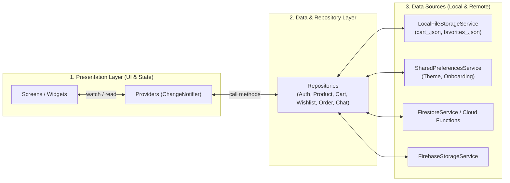

# 🗄️ 02. Thiết Kế Kiến Trúc & Cơ Sở Dữ Liệu (Architecture & Database Design)

> **Dự án:** SmartStore – Hệ thống bán điện thoại di động  
> **Kiến trúc:** Feature-first + Layered Architecture + Provider  
> **Cơ sở dữ liệu:** Cloud Firestore (NoSQL) + Local JSON File Storage (`path_provider`)

---

## 1. Kiến trúc phần mềm Flutter (Application Architecture)

Dự án áp dụng mô hình **Feature-first kết hợp Layered Architecture** và quản lý trạng thái bằng **Provider**. Nguyên tắc cốt lõi: **Tuyệt đối không viết truy vấn Firestore hoặc đọc/ghi file JSON trực tiếp bên trong các màn hình UI (Widgets/Screens)**.



### 1.1. Cấu trúc thư mục `lib/` chuẩn của dự án

```text
lib/
├── main.dart
├── firebase_options.dart
│
├── app/
│   ├── app.dart
│   ├── routes/
│   │   └── app_router.dart               # Cấu hình GoRouter & Route Guard cho Admin
│   └── theme/
│       ├── app_colors.dart
│       └── app_theme.dart                # Thiết lập Material 3 Theme (Google Fonts)
│
├── core/
│   ├── constants/
│   │   ├── app_constants.dart
│   │   └── firestore_collections.dart
│   ├── errors/
│   │   └── app_exception.dart
│   ├── services/
│   │   ├── local_notification_service.dart # Cấu hình flutter_local_notifications + FCM
│   │   └── connectivity_service.dart       # Theo dõi trạng thái mạng (Offline/Online)
│   ├── utils/
│   │   ├── currency_formatter.dart         # Định dạng tiền VND (intl)
│   │   └── validators.dart
│   └── widgets/                            # Các Widget dùng chung (Loading, Shimmer, CustomButton)
│
├── data/
│   ├── local/
│   │   ├── local_file_storage_service.dart # Đọc/ghi cart_<uid>.json & favorites_<uid>.json
│   │   └── preferences_service.dart        # Lưu cài đặt nhẹ bằng shared_preferences
│   ├── remote/
│   │   ├── auth_service.dart
│   │   ├── firestore_service.dart
│   │   └── storage_service.dart
│   ├── models/
│   │   ├── user_model.dart
│   │   ├── product_model.dart
│   │   ├── variant_model.dart
│   │   ├── cart_item_model.dart
│   │   ├── order_model.dart
│   │   └── address_model.dart
│   └── repositories/
│       ├── auth_repository.dart
│       ├── product_repository.dart
│       ├── cart_repository.dart            # Kết hợp LocalFileStorageService + Firestore
│       ├── wishlist_repository.dart        # Kết hợp LocalFileStorageService + Firestore
│       ├── order_repository.dart
│       └── chat_repository.dart
│
├── features/
│   ├── auth/                               # Login, Register, ForgotPassword
│   ├── home/                               # Home, Banner Slider, Featured Products
│   ├── products/                           # Catalog, Filter/Sort, Product Detail, Compare
│   ├── cart/                               # Cart Screen & Widgets
│   ├── wishlist/                           # Wishlist Screen
│   ├── checkout/                           # Checkout Screen, Order Success
│   ├── orders/                             # My Orders, Order Detail
│   ├── profile/                            # Profile, Address Management
│   ├── notifications/                      # Notification List
│   ├── chat/                               # Customer Support Chat
│   ├── maps/                               # Store Location (Google Maps)
│   └── admin/                              # Admin Dashboard, Products, Variants, Orders, QR Scanner
│
└── providers/
    ├── auth_provider.dart
    ├── product_provider.dart
    ├── cart_provider.dart
    ├── wishlist_provider.dart
    ├── order_provider.dart
    ├── notification_provider.dart
    └── chat_provider.dart
```

### 1.2. Vai trò của các Provider chính

| Provider | Trách nhiệm quản lý trạng thái |
| :--- | :--- |
| **`AuthProvider`** | Theo dõi trạng thái đăng nhập (`User?`), thông tin hồ sơ (`UserModel`), quyền Admin (`isAdmin`), xử lý Login/Register/Logout. |
| **`ProductProvider`** | Tải danh sách sản phẩm, thương hiệu, danh mục; xử lý tìm kiếm, lọc (giá, hãng, RAM, ROM), sắp xếp và trạng thái chọn biến thể (`selectedVariant`). |
| **`CartProvider`** | Thêm/xóa/cập nhật số lượng sản phẩm trong giỏ, tính tổng tiền (`subtotalVnd`), điều phối lưu vào `cart_<uid>.json` và đồng bộ với Firestore. |
| **`WishlistProvider`** | Thêm/xóa sản phẩm yêu thích, lưu vào `favorites_<uid>.json` và đồng bộ với subcollection `wishlist` trên Firestore. |
| **`OrderProvider`** | Thực hiện gửi yêu cầu đặt hàng (Checkout), tải lịch sử đơn hàng của khách, hủy đơn và hỗ trợ Admin cập nhật trạng thái đơn. |
| **`NotificationProvider`** | Quản lý danh sách thông báo trong ứng dụng, đếm số thông báo chưa đọc, đánh dấu đã đọc và kích hoạt Local Notification. |
| **`ChatProvider`** | Lắng nghe luồng tin nhắn thời gian thực (`Stream`) giữa khách hàng và cửa hàng. |

---

## 2. Thiết kế cơ sở dữ liệu Cloud Firestore (NoSQL Schema)

Trong lĩnh vực bán lẻ điện thoại di động, hệ thống phải phân biệt rõ 3 thực thể: **Sản phẩm gốc (`Product`)**, **Phiên bản cấu hình/màu sắc (`Variant`)** và **Đơn hàng (`Order`)**.
- Ví dụ: *iPhone 16* là 1 `Product`, nhưng *iPhone 16 128GB Black* và *iPhone 16 256GB Pink* là 2 `Variant` khác nhau với mã SKU, mức giá và số lượng tồn kho (`stock`) độc lập.

### 2.1. Sơ đồ cây cấu trúc Cloud Firestore

```text
smartstore-firebase (Cloud Firestore Root)
│
├── users (Collection)
│   └── {userId} (Document)
│       ├── addresses (Subcollection)     --> {addressId}
│       ├── cart (Subcollection)          --> {variantId}
│       ├── wishlist (Subcollection)      --> {productId}
│       └── notifications (Subcollection) --> {notificationId}
│
├── brands (Collection)
│   └── {brandId} (Document: apple, samsung, xiaomi, oppo...)
│
├── categories (Collection)
│   └── {categoryId} (Document: smartphones, accessories...)
│
├── products (Collection)
│   └── {productId} (Document: iphone_16, galaxy_s25...)
│       ├── variants (Subcollection)      --> {variantId} (SKU, màu, RAM, ROM, giá, tồn kho)
│       └── reviews (Subcollection)       --> {reviewId}
│
├── orders (Collection)
│   └── {orderId} (Document: Lưu snapshot sản phẩm & giá tại thời điểm mua)
│
├── chats (Collection)
│   └── {chatId} (Document: thường lấy theo userId của khách)
│       └── messages (Subcollection)      --> {messageId}
│
├── banners (Collection)
│   └── {bannerId} (Document)
│
└── coupons (Collection)
    └── {couponId} (Document)
```

### 2.2. Chi tiết các Collection & Subcollection

| Collection / Subcollection | Trường dữ liệu chính (Fields) | Công dụng |
| :--- | :--- | :--- |
| **`users`** | `uid`, `name`, `email`, `phone`, `photoUrl`, `role`, `fcmToken`, `createdAt` | Lưu hồ sơ người dùng và token nhận thông báo |
| **`users/{uid}/addresses`** | `id`, `fullName`, `phone`, `addressLine`, `city`, `isDefault` | Sổ địa chỉ nhận hàng của khách |
| **`brands`** | `id`, `name`, `slug`, `logoUrl`, `isActive` | Danh sách hãng điện thoại |
| **`categories`** | `id`, `name`, `imageUrl`, `sortOrder` | Danh mục sản phẩm |
| **`products`** | `name`, `slug`, `brandId`, `categoryId`, `description`, `specs`, `priceFromVnd`, `thumbnailUrl`, `isActive`, `isFeatured`, `createdAt` | Thông tin chung của một dòng điện thoại |
| **`products/{id}/variants`** | `sku`, `color`, `colorHex`, `ramGB`, `storageGB`, `priceVnd`, `stock`, `imageUrls`, `isActive` | Phiên bản cụ thể (Màu + RAM + ROM), giá bán & tồn kho |
| **`orders`** | `orderCode`, `userId`, `items` (Array snapshot), `subtotalVnd`, `shippingFeeVnd`, `discountVnd`, `totalVnd`, `paymentMethod`, `status`, `shippingAddress`, `createdAt` | Đơn đặt hàng của khách |
| **`users/{uid}/cart`** | `productId`, `variantId`, `productName`, `variantLabel`, `priceVnd`, `quantity`, `imageUrl`, `updatedAt` | Giỏ hàng đồng bộ trên Cloud |
| **`users/{uid}/wishlist`** | `productId`, `productName`, `priceFromVnd`, `thumbnailUrl`, `createdAt` | Danh sách yêu thích đồng bộ trên Cloud |
| **`users/{uid}/notifications`** | `title`, `body`, `type`, `orderId`, `isRead`, `createdAt` | Lịch sử thông báo của người dùng |
| **`chats/{chatId}/messages`** | `senderId`, `text`, `imageUrl`, `createdAt`, `isRead` | Tin nhắn hỗ trợ trực tuyến |

---

### 2.3. Mẫu JSON Document chuẩn trên Cloud Firestore

#### A. Document Sản phẩm: `products/iphone_16`
```json
{
  "name": "iPhone 16",
  "slug": "iphone-16",
  "brandId": "apple",
  "categoryId": "smartphones",
  "description": "Điện thoại Apple iPhone 16 chính hãng VN/A với chip A18 mạnh mẽ.",
  "thumbnailUrl": "https://firebasestorage.googleapis.com/.../iphone16.jpg",
  "priceFromVnd": 18990000,
  "specs": {
    "screen": "6.1 inch Super Retina XDR OLED",
    "chip": "Apple A18",
    "camera": "48MP Fusion + 12MP Ultra Wide",
    "battery": "3561 mAh"
  },
  "searchKeywords": ["iphone", "iphone 16", "apple", "ip16"],
  "isActive": true,
  "isFeatured": true,
  "createdAt": "2026-10-01T08:00:00Z (Firestore Timestamp)"
}
```

#### B. Document Biến thể (Subcollection): `products/iphone_16/variants/iphone16_128_black`
```json
{
  "sku": "IP16-128-BLK",
  "color": "Black",
  "colorHex": "#1C1C1E",
  "ramGB": 8,
  "storageGB": 128,
  "priceVnd": 18990000,
  "stock": 12,
  "imageUrls": [
    "https://firebasestorage.googleapis.com/.../iphone16-black-1.jpg",
    "https://firebasestorage.googleapis.com/.../iphone16-black-2.jpg"
  ],
  "isActive": true
}
```

#### C. Document Đơn hàng (Snapshot): `orders/{orderId}`
> **Tại sao phải lưu Snapshot tên và giá sản phẩm vào `orders`?**  
> Nếu hôm nay khách mua iPhone 16 với giá `18.990.000đ`, tuần sau Admin tăng giá lên `19.490.000đ`, thì hóa đơn cũ của khách bắt buộc phải giữ nguyên mức giá `18.990.000đ` tại thời điểm đặt mua. Do đó, mảng `items` trong `orders` phải lưu bản chụp (snapshot) đầy đủ thông tin.

```json
{
  "orderCode": "SS-2026-0001",
  "requestId": "req-uuid-v4-unique",
  "userId": "firebase-user-uid-123",
  "items": [
    {
      "productId": "iphone_16",
      "variantId": "iphone16_128_black",
      "productName": "iPhone 16",
      "variantLabel": "8GB / 128GB - Black",
      "imageUrl": "https://firebasestorage.googleapis.com/.../iphone16-black-1.jpg",
      "quantity": 1,
      "unitPriceVnd": 18990000,
      "lineTotalVnd": 18990000
    }
  ],
  "subtotalVnd": 18990000,
  "shippingFeeVnd": 30000,
  "discountVnd": 0,
  "totalVnd": 19020000,
  "paymentMethod": "cod",
  "paymentStatus": "unpaid",
  "status": "pending",
  "restocked": false,
  "shippingAddress": {
    "fullName": "Nguyen Van A",
    "phone": "0901234567",
    "addressLine": "Lô E2a-7, Đường D1, Khu Công Nghệ Cao, TP. Thủ Đức, TP.HCM"
  },
  "createdAt": "2026-10-26T08:00:00Z (Firestore Timestamp)",
  "updatedAt": "2026-10-26T08:00:00Z (Firestore Timestamp)"
}
```

---

## 3. Thiết kế Local JSON File Storage (Thay thế SQLite)

Theo định hướng của giảng viên môn PRM393, dự án sử dụng **`path_provider` + `dart:io` + `dart:convert`** để lưu trữ dữ liệu cục bộ dưới dạng các tệp JSON trong thư mục `ApplicationDocumentsDirectory` của ứng dụng Android.

### 3.1. Danh sách các file JSON cục bộ trên thiết bị Android

Để đảm bảo khi đổi tài khoản trên cùng một chiếc điện thoại không bị lộ dữ liệu của người dùng trước, tên file được gắn hậu tố `safeUserId` (mã hóa `base64Url` của `userId`, hoặc dùng `"guest"` khi chưa đăng nhập):

| Tên file trong bộ nhớ máy | Mục đích sử dụng |
| :--- | :--- |
| `cart_<safeUserId>.json` | Lưu danh sách các biến thể sản phẩm trong giỏ hàng của người dùng hiện tại |
| `favorites_<safeUserId>.json` | Lưu danh sách các sản phẩm yêu thích (Wishlist) của người dùng hiện tại |
| `catalog_cache.json` *(Tùy chọn)* | Lưu bản chụp danh sách sản phẩm nổi bật gần nhất để hiển thị ngay khi mở app không có mạng |

### 3.2. Cấu trúc Schema của `cart_<safeUserId>.json`

```json
{
  "schemaVersion": 1,
  "userId": "firebase-user-uid-123",
  "updatedAt": "2026-10-26T08:10:00.000Z",
  "items": [
    {
      "productId": "iphone_16",
      "variantId": "iphone16_128_black",
      "productName": "iPhone 16",
      "variantLabel": "8GB / 128GB - Black",
      "priceVnd": 18990000,
      "quantity": 1,
      "imageUrl": "https://firebasestorage.googleapis.com/.../iphone16-black-1.jpg",
      "updatedAt": "2026-10-26T08:05:00.000Z"
    },
    {
      "productId": "samsung_s25",
      "variantId": "s25_256_silver",
      "productName": "Samsung Galaxy S25",
      "variantLabel": "12GB / 256GB - Silver",
      "priceVnd": 22990000,
      "quantity": 2,
      "imageUrl": "https://firebasestorage.googleapis.com/.../s25-silver.jpg",
      "updatedAt": "2026-10-26T08:10:00.000Z"
    }
  ]
}
```

### 3.3. Cấu trúc Schema của `favorites_<safeUserId>.json`

```json
{
  "schemaVersion": 1,
  "userId": "firebase-user-uid-123",
  "updatedAt": "2026-10-26T08:12:00.000Z",
  "items": [
    {
      "productId": "iphone_16",
      "productName": "iPhone 16",
      "brandId": "apple",
      "priceFromVnd": 18990000,
      "thumbnailUrl": "https://firebasestorage.googleapis.com/.../iphone16.jpg",
      "createdAt": "2026-10-26T08:12:00.000Z"
    }
  ]
}
```

---

## 4. Cơ chế đồng bộ Local File Storage ↔ Cloud Firestore

Đây là điểm nhấn kỹ thuật giúp đồ án chứng minh khả năng xử lý **Offline-First & Cloud Sync**:

1. **Khi người dùng thêm/sửa/xóa giỏ hàng:**
   - **Bước 1 (Local-first):** `CartRepository` cập nhật ngay vào file `cart_<uid>.json` thông qua `LocalFileStorageService` và gọi `notifyListeners()` trong `CartProvider` để giao diện Android phản hồi tức thì (0ms độ trễ mạng).
   - **Bước 2 (Cloud Sync):** Nếu người dùng đã đăng nhập (`uid != 'guest'`), ghi nhận thay đổi lên subcollection `users/{uid}/cart/{variantId}` của Cloud Firestore.
2. **Khi người dùng mở ứng dụng trong chế độ Offline (Mất mạng):**
   - `CartProvider` và `WishlistProvider` đọc trực tiếp từ `cart_<uid>.json` và `favorites_<uid>.json`. Người dùng vẫn xem được giỏ hàng, chỉnh sửa số lượng, hoặc xóa sản phẩm bình thường.
3. **Khi có kết nối Internet trở lại hoặc đăng nhập trên thiết bị mới:**
   - Hệ thống đọc danh sách từ `cart_<uid>.json` (Local) và `users/{uid}/cart` (Cloud).
   - **Quy tắc hợp nhất (Merge Rule theo Last-Write-Wins):** So sánh từng `variantId` dựa trên trường `updatedAt`. Bản ghi nào có `updatedAt` mới hơn sẽ được giữ lại (không tự động cộng dồn số lượng để tránh nhân đôi giỏ hàng ngoài ý muốn). Sau khi hợp nhất, ghi đè bản chuẩn xuống cả file JSON và Firestore.
4. **Khi người dùng Đăng xuất (Logout):**
   - Chuyển phiên làm việc hiện tại về `userId = "guest"`. File `cart_<uid>.json` của tài khoản cũ được tách biệt hoàn toàn, đảm bảo người dùng kế tiếp không nhìn thấy giỏ hàng của người trước.

---

## 5. Bảo mật & Phân quyền (Firestore Security Rules)

File cấu hình `firestore.rules` dùng để bảo vệ dữ liệu trên Cloud Firestore:

```javascript
rules_version = '2';

service cloud.firestore {
  match /databases/{database}/documents {

    function signedIn() {
      return request.auth != null;
    }

    function isOwner(uid) {
      return signedIn() && request.auth.uid == uid;
    }

    function isAdmin() {
      return signedIn() && (
        request.auth.token.admin == true ||
        get(/databases/$(database)/documents/users/$(request.auth.uid)).data.role == 'admin'
      );
    }

    // 1. Hồ sơ người dùng & các subcollection cá nhân
    match /users/{uid} {
      allow read: if isOwner(uid) || isAdmin();
      // Khách hàng chỉ được tạo/cập nhật hồ sơ của chính mình và không được tự gán role = 'admin'
      allow create: if isOwner(uid) && (!('role' in request.resource.data) || request.resource.data.role == 'customer');
      allow update: if isOwner(uid) && (!request.resource.data.diff(resource.data).affectedKeys().hasAny(['role'])) || isAdmin();

      match /addresses/{addressId} {
        allow read, write: if isOwner(uid);
      }

      match /cart/{variantId} {
        allow read, write: if isOwner(uid);
      }

      match /wishlist/{productId} {
        allow read, write: if isOwner(uid);
      }

      match /notifications/{notificationId} {
        allow read: if isOwner(uid) || isAdmin();
        allow update: if isOwner(uid); // Đánh dấu đã đọc (isRead = true)
        allow create, delete: if isAdmin();
      }
    }

    // 2. Danh mục, Thương hiệu, Banner (Công khai cho khách đọc, chỉ Admin được ghi)
    match /brands/{brandId} {
      allow read: if true;
      allow write: if isAdmin();
    }

    match /categories/{categoryId} {
      allow read: if true;
      allow write: if isAdmin();
    }

    match /banners/{bannerId} {
      allow read: if true;
      allow write: if isAdmin();
    }

    // 3. Sản phẩm & Biến thể
    match /products/{productId} {
      allow read: if resource.data.isActive == true || isAdmin();
      allow write: if isAdmin();

      match /variants/{variantId} {
        allow read: if true;
        // Chỉ Admin hoặc luồng đặt hàng hợp lệ mới được cập nhật tồn kho
        allow write: if isAdmin();
      }

      match /reviews/{reviewId} {
        allow read: if true;
        allow create: if signedIn();
        allow update, delete: if isAdmin();
      }
    }

    // 4. Đơn hàng
    match /orders/{orderId} {
      allow read: if isAdmin() || (signedIn() && resource.data.userId == request.auth.uid);
      allow create: if signedIn() && request.resource.data.userId == request.auth.uid;
      allow update: if isAdmin() || (
        signedIn() &&
        resource.data.userId == request.auth.uid &&
        resource.data.status in ['pending', 'confirmed'] &&
        request.resource.data.status == 'cancelled'
      );
    }

    // 5. Chat hỗ trợ
    match /chats/{chatId} {
      allow read, write: if isOwner(chatId) || isAdmin();

      match /messages/{messageId} {
        allow read, write: if isOwner(chatId) || isAdmin();
      }
    }
  }
}
```
