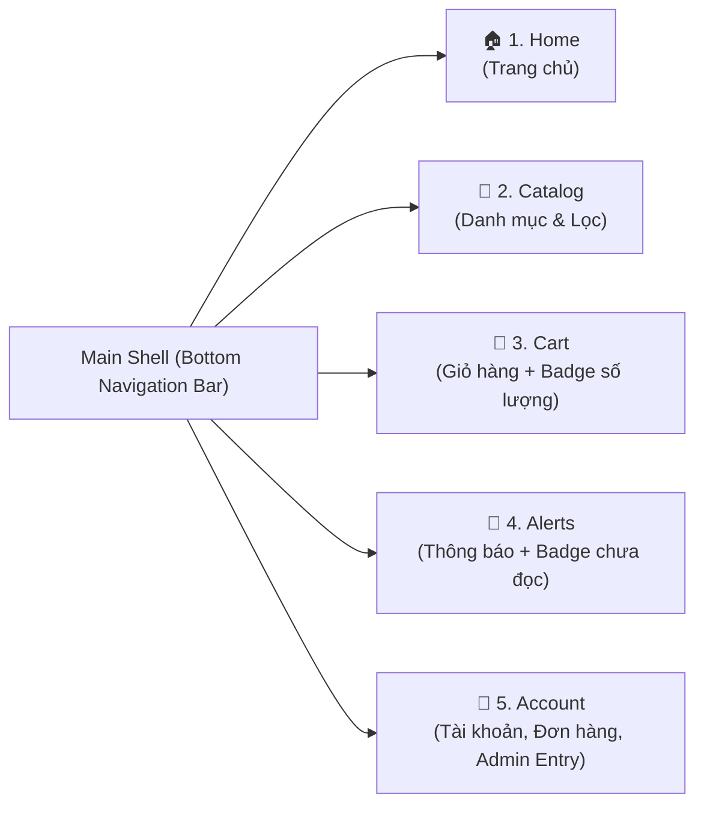

# 🎨 04. Thiết Kế UI/UX & Đặc Tả Các Màn Hình (UI/UX & Screens Specification)

> **Dự án:** SmartStore – Hệ thống bán điện thoại di động  
> **Phong cách chủ đạo:** Công nghệ hiện đại (Modern Tech Store), tối giản, chuẩn Material Design 3 trên Android.

---

## 1. Hệ thống thiết kế (Design System)

### 1.1. Bảng màu (Color Palette)
- **Primary Color (Xanh công nghệ):** `#2563EB` (Royal Blue) – Dùng cho nút CTA chính, chip phiên bản đang chọn, giá tiền nổi bật.
- **Secondary / Dark Accent (Đen Titan):** `#0F172A` (Slate 900) – Dùng cho thanh tiêu đề, chữ chính, nút "Mua ngay".
- **Background (Nền sáng):** `#F8FAFC` (Nền tổng thể) & `#FFFFFF` (Nền thẻ sản phẩm Card).
- **Semantic Colors (Trạng thái):**
  - **Success (`#16A34A`):** Còn hàng (`In Stock`), Giao hàng thành công (`Delivered`).
  - **Warning (`#D97706`):** Sắp hết hàng (`Chỉ còn <= 3 máy`), Đơn đang chờ xác nhận (`Pending`).
  - **Error (`#DC2626`):** Hết hàng (`Out of Stock`), Đơn đã hủy (`Cancelled`), thông báo mất kết nối mạng.

### 1.2. Typography & Hiệu ứng
- **Font chữ (`google_fonts`):** `Inter` hoặc `Plus Jakarta Sans` (hiển thị tiếng Việt và con số tiền tệ VND cực kỳ rõ nét).
- **Hiệu ứng tải dữ liệu:** Sử dụng `shimmer` cho khung xương thẻ điện thoại và `cached_network_image` để lưu cache hình ảnh.
- **Chuyển động (`flutter_animate`):** Hiệu ứng Fade + Slide nhẹ khi chuyển đổi giữa các phiên bản màu sắc điện thoại.

---

## 2. Cấu trúc điều hướng (Navigation & Bottom Navigation Bar)

Thanh điều hướng dưới cùng (`NavigationBar` Material 3) gồm **5 Tab chính** dành cho Khách hàng:



---

## 3. Danh sách toàn bộ 22 màn hình cần xây dựng

### 3.1. Nhóm màn hình Xác thực & Khởi động (4 màn hình)

| STT | Tên màn hình (Screen) | Đường dẫn (`go_router`) | Thành phần UI & Chức năng chính |
| :-: | :--- | :--- | :--- |
| 01 | **Splash Screen** | `/splash` | Logo SmartStore, kiểm tra phiên đăng nhập Firebase Auth, khởi tạo `LocalFileStorageService`. |
| 02 | **Login Screen** | `/login` | Nhập Email, Password, nút Đăng nhập, nút Google Sign-In, link sang Đăng ký & Quên mật khẩu. |
| 03 | **Register Screen** | `/register` | Nhập Họ tên, Số điện thoại, Email, Mật khẩu, Xác nhận mật khẩu; kiểm tra hợp lệ (Validation). |
| 04 | **Forgot Password** | `/forgot-password` | Nhập Email nhận đường dẫn đặt lại mật khẩu từ Firebase Auth. |

### 3.2. Nhóm màn hình Mua sắm & Sản phẩm (6 màn hình)

| STT | Tên màn hình (Screen) | Đường dẫn (`go_router`) | Thành phần UI & Chức năng chính |
| :-: | :--- | :--- | :--- |
| 05 | **Home Screen** | `/home` | Thanh tìm kiếm nhanh, `CarouselSlider` banner khuyến mãi, danh sách ngang các hãng (Apple, Samsung, Xiaomi, OPPO), lưới sản phẩm nổi bật & mới nhất. |
| 06 | **Product List (Catalog)** | `/catalog` | `GridView` 2 cột hiển thị điện thoại, thanh Filter (Khoảng giá, Hãng, RAM, ROM), Sort (Giá tăng/giảm, Mới nhất), phân trang (Pagination). |
| 07 | **Product Detail** | `/products/:id` | Gallery ảnh đa góc, tên máy, giá VND, bộ chọn biến thể (**Màu sắc, RAM, ROM**), số lượng tồn kho, bảng thông số kỹ thuật (Specs), nút Yêu thích & Thêm vào giỏ. |
| 08 | **Compare Phones** *(Nâng cao)* | `/compare` | Bảng đối chiếu trực quan 2–3 mẫu điện thoại (Màn hình, Chip, RAM/ROM, Camera, Pin, Giá). |
| 09 | **Wishlist Screen** | `/wishlist` | Danh sách điện thoại yêu thích đọc từ `favorites_<uid>.json` & Firestore, nút chuyển nhanh sang xem chi tiết hoặc xóa. |
| 10 | **Cart Screen** | `/cart` | Danh sách biến thể trong giỏ (`cart_<uid>.json`), nút `+/-` số lượng, xóa món, hiển thị trạng thái Offline nếu mất mạng, tổng tạm tính và nút sang Checkout. |

### 3.3. Nhóm màn hình Đặt hàng & Cá nhân (8 màn hình)

| STT | Tên màn hình (Screen) | Đường dẫn (`go_router`) | Thành phần UI & Chức năng chính |
| :-: | :--- | :--- | :--- |
| 11 | **Checkout Screen** | `/checkout` | Chọn địa chỉ nhận hàng từ sổ địa chỉ, danh sách tóm tắt sản phẩm, chọn phương thức **COD**, chi tiết tiền hàng + phí ship, nút "Xác nhận đặt hàng". |
| 12 | **Order Success** | `/order-success/:id` | Biểu tượng đặt hàng thành công, mã đơn hàng (`#SS-2026-0001`), mã QR đơn hàng (`qr_flutter`), nút "Xem chi tiết đơn" và "Tiếp tục mua sắm". |
| 13 | **My Orders Screen** | `/orders` | Các Tab lọc theo trạng thái (`Tất cả`, `Chờ xác nhận`, `Đang xử lý`, `Đang giao`, `Hoàn thành`, `Đã hủy`). |
| 14 | **Order Detail Screen** | `/orders/:id` | Timeline tiến trình đơn hàng, thông tin người nhận, danh sách sản phẩm (snapshot giá), tổng thanh toán, mã QR đơn và nút "Hủy đơn hàng" (nếu `pending`/`confirmed`). |
| 15 | **Profile Screen** | `/profile` | Ảnh đại diện, họ tên, email, số điện thoại, lối tắt vào Sổ địa chỉ, Đơn mua, Bản đồ cửa hàng, Chat hỗ trợ, nút vào **Admin Portal** (nếu `isAdmin == true`) và Đăng xuất. |
| 16 | **Address Management** | `/addresses` | Danh sách địa chỉ nhận hàng của khách, form thêm/sửa địa chỉ, đánh dấu địa chỉ mặc định. |
| 17 | **Notifications Screen** | `/notifications` | Danh sách thông báo cập nhật đơn hàng & khuyến mãi, chạm vào thông báo mở trực tiếp màn hình `Order Detail`. |
| 18 | **Chat & Store Map** | `/chat` & `/store-map` | Màn hình nhắn tin thời gian thực với cửa hàng và màn hình Bản đồ Google Maps chỉ đường tới chi nhánh SmartStore. |

### 3.4. Nhóm màn hình Quản trị viên – Admin (4 màn hình)

| STT | Tên màn hình (Screen) | Đường dẫn (`go_router`) | Thành phần UI & Chức năng chính |
| :-: | :--- | :--- | :--- |
| 19 | **Admin Dashboard** | `/admin` | Thẻ thống kê tổng doanh thu, tổng số đơn, số đơn chờ duyệt (`pending`), tổng sản phẩm; điều hướng nhanh tới các phân hệ quản lý. |
| 20 | **Admin Products & Variants** | `/admin/products` | Danh sách sản phẩm, form thêm/sửa điện thoại, quản lý danh sách biến thể (`variants`: thêm SKU, Màu, RAM, ROM, cập nhật giá và số lượng `stock`). |
| 21 | **Admin Orders & QR Scanner** | `/admin/orders` | Danh sách đơn hàng toàn hệ thống, lọc theo trạng thái, nút cập nhật trạng thái đơn (`Confirmed` → `Processing` → `Shipping` → `Delivered`), tích hợp nút **Quét QR đơn hàng (`mobile_scanner`)**. |
| 22 | **Admin Chat Support** | `/admin/chats` | Danh sách các cuộc hội thoại của khách hàng và màn hình trả lời tin nhắn trực tiếp. |

---

## 4. Đặc tả chuyên sâu màn hình Chi tiết sản phẩm (`Product Detail Screen`)

Đây là màn hình quan trọng nhất thể hiện đặc thù của ứng dụng bán điện thoại di động:

```text
+--------------------------------------------------+
| [<-]              iPhone 16                 [❤️] |
+--------------------------------------------------+
|                                                  |
|           [  ẢNH ĐIỆN THOẠI THEO MÀU  ]          |
|                  (Carousel Slider)               |
|                     •  o  o                      |
+--------------------------------------------------+
| iPhone 16 Chính Hãng VN/A                        |
| ⭐ 4.9 (128 đánh giá)    |   Còn hàng: 12 máy    |
|                                                  |
| 18.990.000 ₫                                     |
| (SKU: IP16-128-BLK)                              |
+--------------------------------------------------+
| Chọn Màu sắc:                                    |
| (● Đen [Đang chọn])  (○ Trắng)  (○ Hồng)  (○ Xanh)|
|                                                  |
| Chọn Dung lượng (RAM / ROM):                     |
| [ 8GB / 128GB (Đang chọn) ]   [ 8GB / 256GB ]    |
| [ 8GB / 512GB (Hết hàng)  ]                      |
+--------------------------------------------------+
| Thông số kỹ thuật (Specs):                       |
| • Màn hình: 6.1 inch Super Retina XDR OLED       |
| • Chip xử lý: Apple A18                          |
| • Camera: 48MP Fusion + 12MP Ultra Wide          |
| • Pin: 3561 mAh                                  |
+--------------------------------------------------+
| Số lượng:  [-]  1  [+]                           |
| [ 🛒 Thêm vào giỏ ]        [ ⚡ Mua ngay ]        |
+--------------------------------------------------+
```

### Quy tắc xử lý Logic chọn Biến thể (Variant Selection Logic)
1. Khi mở màn hình `Product Detail`, `ProductProvider` tải thông tin `products/{productId}` cùng toàn bộ danh sách subcollection `variants`.
2. Mặc định chọn biến thể đầu tiên đang còn hàng (`isActive == true && stock > 0`).
3. Khi người dùng chạm đổi **Màu sắc** hoặc **Dung lượng (RAM/ROM)**:
   - Tìm biến thể khớp với tổ hợp `(color, storageGB)` trong danh sách `variants`.
   - Cập nhật ngay lập tức trên UI: **Bộ ảnh (`imageUrls`)**, **Giá bán (`priceVnd`)**, **Mã `SKU`** và **Số lượng tồn kho (`stock`)**.
   - Nếu biến thể có `stock == 0`, hiển thị nhãn **"Hết hàng"** màu đỏ và vô hiệu hóa (disable) nút *"Thêm vào giỏ"* / *"Mua ngay"*.
4. Khi bấm **"Thêm vào giỏ"**, truyền chính xác `variantId` đã chọn xuống `CartProvider` để ghi vào file `cart_<uid>.json` và đồng bộ lên Cloud Firestore.
