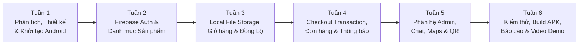

# 👥 05. Kế Hoạch Nhóm, Kiểm Thử & Hướng Dẫn Báo Cáo (Team Plan, Testing & Report Guide)

> **Dự án:** SmartStore – Hệ thống bán điện thoại di động  
> **Môn học:** PRM393 – Mobile Programming (Nhóm 3 thành viên: 34% – 33% – 33%)

---

## 1. Phân chia công việc nhóm 3 thành viên (Contribution Table)

Tỷ lệ đóng góp được giữ chuẩn **34% – 33% – 33%** như trong báo cáo gốc, đồng thời cập nhật từ SQLite sang **Local JSON File Storage (`path_provider`)** và bổ sung hệ thống thông báo Android (`flutter_local_notifications`).

| Thành viên | Tỷ lệ | Nhiệm vụ kỹ thuật & Module phụ trách |
| :--- | :---: | :--- |
| **Member A** | **34%** | • Thiết lập Firebase Project, cấu hình Android Gradle (`compileSdk`, `coreLibraryDesugaring`, Google Services). • Xây dựng `AuthService`, `AuthRepository` (Firebase Auth: Login, Register, Forgot Password, Role Admin). • Thiết kế Cloud Firestore Schema (`products`, `variants`, `orders`, `users`) & nhập dữ liệu mẫu thực tế. • Xây dựng **`LocalFileStorageService`** (`cart_<uid>.json`, `favorites_<uid>.json` bằng `path_provider` + `dart:io`). • Xây dựng `OrderRepository` & xử lý đặt hàng an toàn bằng **Firestore Transaction / Cloud Functions**. • Viết và kiểm thử **Firestore Security Rules**. |
| **Member B** | **33%** | • Xây dựng Design System (`AppTheme`, `AppColors`, `google_fonts`, `shimmer`, `flutter_animate`). • Cấu hình điều hướng `go_router` và Bottom Navigation Bar. • Phát triển giao diện (UI) các màn hình: Splash, Login, Register, Forgot Password. • Phát triển giao diện Home Screen (Carousel Banner, Danh mục), Product List (Filter, Sort, Pagination). • Phát triển giao diện **Product Detail Screen** (Chọn biến thể Màu sắc, RAM, ROM), Cart Screen, Checkout Screen, Profile & Address Management. • Đảm bảo Responsive UI không bị lỗi tràn viền (`overflow`) trên các màn hình Android. |
| **Member C** | **33%** | • Xây dựng tầng State Management (`Provider`: `CartProvider`, `WishlistProvider`, `OrderProvider`, `NotificationProvider`, `ChatProvider`). • Lập trình cơ chế đồng bộ 2 chiều **Local JSON File Storage ↔ Cloud Firestore** và xử lý Offline Mode (`connectivity_plus`). • Tích hợp **`LocalNotificationService` (`flutter_local_notifications` + `firebase_messaging`)** trên Android. • Phát triển màn hình Wishlist, Order History, Order Detail (kèm tạo/quét QR đơn hàng), Chat hỗ trợ, Google Maps (`Store Location`) và các màn hình Admin. • Viết Widget Test, Integration Test và đóng gói bản cài đặt **APK Release**. |

> **Nguyên tắc phối hợp nhóm:** Trong **Tuần 1**, cả 3 thành viên phải chốt chung các class trong `lib/data/models/` (`ProductModel`, `VariantModel`, `CartItemModel`, `OrderModel`) và chữ ký hàm (interface) của `Repositories` để Member B và Member C có thể làm việc song song với Member A mà không bị xung đột dữ liệu.

---

## 2. Lộ trình triển khai 6 tuần (6-Week Implementation Roadmap)

| Tuần | Mục tiêu trọng tâm | Kết quả đầu ra (Deliverables) |
| :---: | :--- | :--- |
| **Tuần 1** | **Phân tích & Khởi tạo nền tảng** | Chốt cấu trúc thư mục `lib/`, cấu hình `build.gradle.kts` (Desugaring, Java 17), kết nối Firebase, thống nhất `Models` & `Repositories`. |
| **Tuần 2** | **Authentication & Catalog** | Hoàn thành Đăng ký/Đăng nhập/Quên mật khẩu; đẩy bộ dữ liệu mẫu điện thoại (iPhone, Samsung, Xiaomi, OPPO + các biến thể SKU) lên Firestore; hoàn thiện màn hình Home, Catalog & Product Detail. |
| **Tuần 3** | **Local File Storage & Giỏ hàng** | Hoàn thành `LocalFileStorageService` đọc/ghi `cart_<uid>.json` và `favorites_<uid>.json`; hoàn thiện chọn biến thể thêm vào giỏ, tính tổng tiền và đồng bộ Offline ↔ Firestore. |
| **Tuần 4** | **Checkout, Đơn hàng & Thông báo** | Hoàn thành đặt hàng COD với Firestore Transaction kiểm tra tồn kho & giá; hoàn thiện Order Success, Order History, Order Detail, Hủy đơn và thông báo `flutter_local_notifications`. |
| **Tuần 5** | **Admin & Tính năng mở rộng** | Hoàn thành Admin Dashboard, Quản lý sản phẩm/biến thể/tồn kho, Duyệt đơn hàng (kèm quét QR), Chat hỗ trợ khách hàng và Google Maps vị trí cửa hàng. |
| **Tuần 6** | **Testing, Đóng gói & Báo cáo** | Chạy toàn bộ 18 Test Cases, kiểm tra Firestore Security Rules, xuất file `app-release.apk`, hoàn thiện Technical Report và quay Video Demo. |

---

## 3. Bảng 18 Kịch bản Kiểm thử (Test Cases Specification)

Bộ kiểm thử dưới đây bao phủ toàn bộ yêu cầu nghiệp vụ, lưu trữ file cục bộ (`cart.json`), đồng bộ đám mây, bảo mật và thông báo trên Android:

| Test ID | Trường hợp kiểm thử (Test Case) | Các bước thực hiện | Kết quả mong đợi (Expected Result) |
| :---: | :--- | :--- | :--- |
| **TC01** | Đăng ký tài khoản hợp lệ | Nhập Họ tên, Email mới, Password `>= 6` ký tự và bấm Đăng ký. | Tạo tài khoản Firebase Auth và document `users/{uid}` thành công. |
| **TC02** | Đăng nhập sai mật khẩu | Nhập Email đúng nhưng Password sai, bấm Đăng nhập. | Hiển thị thông báo lỗi tiếng Việt rõ ràng, không bị văng ứng dụng. |
| **TC03** | Tìm kiếm & Lọc điện thoại | Tìm từ khóa `"iPhone"` và lọc dung lượng `128GB`. | Trả về đúng danh sách các mẫu iPhone có phiên bản 128GB đang hoạt động (`isActive == true`). |
| **TC04** | Chọn biến thể (Màu / RAM / ROM) | Trong màn hình Product Detail, đổi từ bản `128GB - Black` sang `256GB - Pink`. | Ảnh sản phẩm, mã SKU, giá bán VND và số lượng tồn kho (`stock`) trên UI cập nhật ngay lập tức. |
| **TC05** | Thêm sản phẩm vào giỏ hàng | Chọn biến thể còn hàng và bấm `"Thêm vào giỏ"`. | File `cart_<uid>.json` trên thiết bị Android lưu đúng `variantId`, `priceVnd` và `quantity`. |
| **TC06** | Đóng ứng dụng và mở lại | Thêm sản phẩm vào giỏ, đóng hẳn app (Kill app) rồi mở lại. | Giỏ hàng vẫn giữ nguyên các sản phẩm đã chọn nhờ đọc từ `cart_<uid>.json`. |
| **TC07** | Kiểm tra chế độ Offline (Mất mạng) | Tắt Wi-Fi/4G trên máy Android, mở màn hình Giỏ hàng và Danh sách yêu thích. | Vẫn xem, tăng/giảm số lượng hoặc xóa sản phẩm trong giỏ bình thường từ `cart_<uid>.json`. |
| **TC08** | Đồng bộ khi có Internet trở lại | Bật lại Wi-Fi/4G sau khi chỉnh sửa giỏ hàng ở chế độ Offline. | Dữ liệu từ `cart_<uid>.json` tự động đồng bộ lên `users/{uid}/cart` theo mốc `updatedAt` mới nhất. |
| **TC09** | Tính tổng tiền số nguyên VND | Tăng số lượng biến thể trong giỏ lên `2` hoặc `3`. | Tổng tiền tính chính xác tuyệt đối bằng kiểu `int`, định dạng đúng chuẩn `xx.xxx.xxx ₫`. |
| **TC10** | Đặt hàng vượt quá tồn kho | Chọn số lượng mua lớn hơn `stock` hiện có trên Firestore và bấm Đặt hàng. | Transaction trên Server từ chối tạo đơn và báo lỗi `"Sản phẩm không đủ tồn kho"`. |
| **TC11** | Đặt hàng COD hợp lệ & Thông báo | Nhập địa chỉ, chọn COD và bấm `"Xác nhận đặt hàng"`. | Tạo đúng 1 document `orders/{orderId}`, trừ `stock` tương ứng, xóa sạch `cart_<uid>.json` và **hiển thị Local Notification trên thanh trạng thái Android**. |
| **TC12** | Chống đặt hàng trùng lặp (Double Tap) | Bấm liên tiếp 2 lần thật nhanh vào nút `"Xác nhận đặt hàng"`. | Nút bấm bị khóa (`isLoading`) ngay từ lần chạm đầu tiên + kiểm tra `requestId`, chỉ tạo duy nhất 1 đơn hàng. |
| **TC13** | Kiểm tra quyền riêng tư đơn hàng | Dùng tài khoản User A cố tình truy cập `orderId` của User B. | Firestore Security Rules từ chối quyền đọc (`PERMISSION_DENIED`). |
| **TC14** | Bảo mật giá khi tạo đơn | Giả lập giá trong `cart.json` khác với giá thực tế trên Firestore rồi bấm Đặt hàng. | Hệ thống sử dụng đơn giá thực tế trên Firestore để tính `totalVnd` trong đơn hàng. |
| **TC15** | Admin cập nhật trạng thái đơn | Admin đổi trạng thái đơn từ `pending` sang `confirmed` / `shipping`. | Khách hàng thấy trạng thái mới trong `Order Detail` theo thời gian thực và nhận được thông báo. |
| **TC16** | Đăng xuất và đổi tài khoản khác | User A đăng xuất, User B đăng nhập trên cùng điện thoại Android. | File `cart_<uid_B>.json` tách biệt hoàn toàn với `cart_<uid_A>.json`, không lộ giỏ hàng của User A. |
| **TC17** | Flutter Widget Test | Chạy lệnh `flutter test` kiểm tra thẻ sản phẩm và nút Add to Cart. | Bài kiểm thử Widget vượt qua (Pass 100%). |
| **TC18** | Đóng gói bản cài đặt Android | Chạy lệnh `flutter build apk --release`. | Xuất thành công file `build/app/outputs/flutter-apk/app-release.apk` cài đặt mượt trên máy Android. |

---

## 4. Kịch bản Trình diễn Demo Đồ án (Demo Script 5–7 phút)

Để buổi bảo vệ đồ án môn **PRM393** thuyết phục giảng viên nhất, nhóm nên trình diễn theo đúng kịch bản liền mạch sau:

1. **Bước 1 – Khởi động & Xác thực (Customer):**
   - Mở ứng dụng SmartStore trên thiết bị Android, đăng nhập tài khoản khách hàng.
2. **Bước 2 – Tìm kiếm & Chọn biến thể điện thoại:**
   - Tìm kiếm `"iPhone 16"`, mở trang Chi tiết sản phẩm, bấm chuyển đổi giữa các màu sắc và dung lượng (`128GB` ↔ `256GB`) để chứng minh giá bán, ảnh và số lượng tồn kho (`stock`) thay đổi theo thời gian thực.
   - Bấm thêm vào Yêu thích (`Wishlist`) và bấm `"Thêm vào giỏ hàng"`.
3. **Bước 3 – Chứng minh Local JSON File Storage & Offline Mode:**
   - **Tắt Wi-Fi / Dữ liệu di động trên thanh trạng thái Android.**
   - Đóng ứng dụng và mở lại, vào màn hình Giỏ hàng và Yêu thích: dữ liệu vẫn hiển thị đầy đủ từ file `cart_<uid>.json` và `favorites_<uid>.json`. Tăng số lượng sản phẩm khi đang Offline.
4. **Bước 4 – Đồng bộ mạng, Checkout & Local Notification:**
   - **Bật lại Wi-Fi**, giỏ hàng tự động đồng bộ lên Cloud Firestore.
   - Vào màn hình `Checkout`, chọn địa chỉ nhận hàng, chọn phương thức **COD** và bấm `"Xác nhận đặt hàng"`.
   - Ngay khi đặt thành công: thanh trạng thái Android bật **Local Notification** *"Đặt hàng thành công! Đơn hàng #SS-2026-0001 đang chờ xác nhận"*, màn hình chuyển sang `Order Success` kèm mã QR đơn hàng, giỏ hàng được làm sạch.
5. **Bước 5 – Quản trị viên xử lý đơn (Admin):**
   - Đăng nhập tài khoản Admin, mở `Admin Dashboard` xem doanh thu và đơn mới.
   - Vào `Admin Orders`, duyệt đơn hàng từ `Pending` → `Confirmed` → `Shipping` và kiểm tra số lượng tồn kho (`stock`) của biến thể đã tự động giảm đi.
6. **Bước 6 – Khách hàng kiểm tra kết quả:**
   - Quay lại màn hình `Order Detail` của khách hàng, thấy trạng thái đơn đã cập nhật sang `Đang giao hàng (Shipping)`.

---

## 5. Hướng dẫn cập nhật Technical Report (So với báo cáo ban đầu)

Khi viết quyển báo cáo kỹ thuật (Technical Report) nộp cho giảng viên môn PRM393, nhóm cần cập nhật các mục sau:

| Mục trong Báo cáo | Nội dung cần cập nhật mới |
| :--- | :--- |
| **1. Case Study Overview** | Chuyển sang hệ thống bán lẻ điện thoại di động & phụ kiện công nghệ (**SmartStore**), nhấn mạnh bài toán quản lý đa biến thể (`Product Variants`). |
| **2. Business Analysis** | Bổ sung phân tích nghiệp vụ chọn biến thể (Màu/RAM/ROM), kiểm soát tồn kho theo SKU, quy trình đơn hàng 5 trạng thái và phân hệ Admin. |
| **3. System Architecture** | Cập nhật sơ đồ kiến trúc: **Flutter (Android) + Provider + Local JSON File Storage (`path_provider`) + Firebase Auth + Cloud Firestore + Firebase Storage + Notifications (`FCM` & `flutter_local_notifications`)**. |
| **4. Database Design** | Thay thế thiết kế SQLite đơn giản cũ bằng thiết kế **Hybrid Storage**: Sơ đồ cây Cloud Firestore (`products`, `variants`, `orders` snapshot) kết hợp cấu trúc file JSON cục bộ (`cart_<uid>.json`, `favorites_<uid>.json`). |
| **5. Android Platform Configuration** | Bổ sung mục cấu hình chuyên biệt cho Android: `build.gradle.kts` với `isCoreLibraryDesugaringEnabled = true`, `desugar_jdk_libs`, quyền `POST_NOTIFICATIONS` trên Android 13+, `CAMERA`, `ACCESS_FINE_LOCATION`. |
| **6. Testing & Verification** | Thay bảng 2 test case cũ bằng bảng **18 Test Cases (TC01–TC18)** kiểm thử đầy đủ từ UI, File Storage Offline, Đồng bộ, Transaction tồn kho đến Security Rules. |
| **7. Conclusion** | Đánh giá ưu điểm của kiến trúc **Local JSON File Storage + Cloud Firestore** (gọn nhẹ, phản hồi tức thì, đồng bộ linh hoạt) và định hướng mở rộng (Thanh toán trực tuyến VNPay/MoMo, AI gợi ý sản phẩm). |
